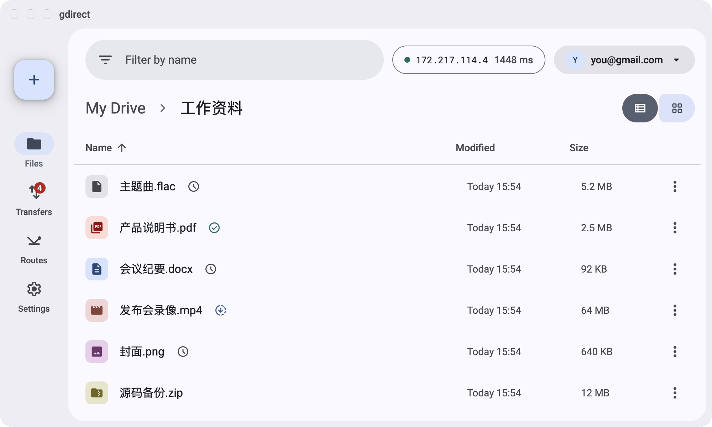
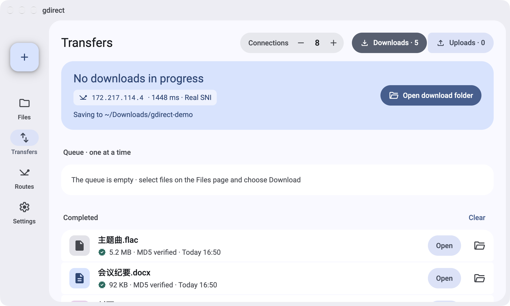
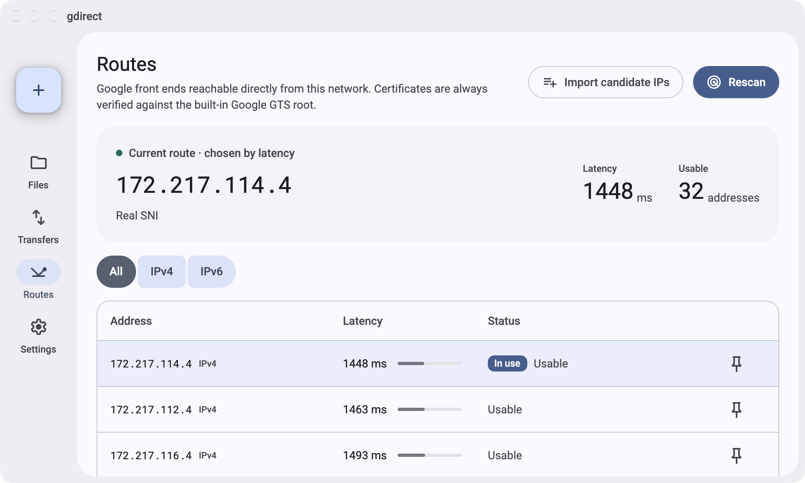
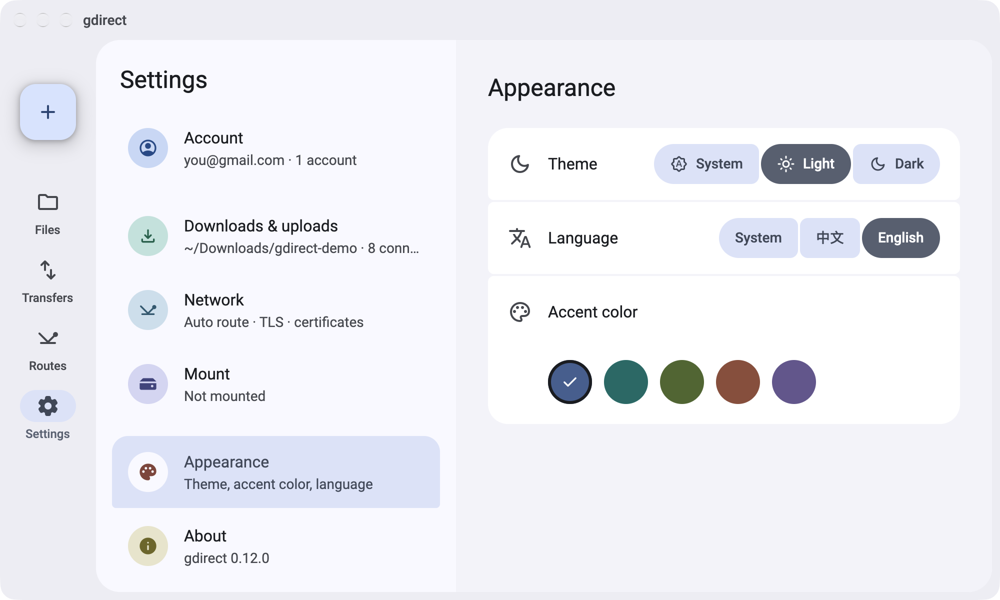

# gdirect

[](https://github.com/mizorewww/gdirect/releases/latest)
[](https://github.com/mizorewww/gdirect/actions/workflows/ci.yml)
[](LICENSE)

[中文](README.zh-CN.md) · [Changelog](CHANGELOG.md)

Browse, download, upload and mount your Google Drive from networks where Google is blocked, without a proxy for the transfers themselves. gdirect finds Google front-end IPs that your network can still reach and sends Drive traffic straight to them, with multi-connection, resumable downloads.

<picture>
  <source media="(prefers-color-scheme: dark)" srcset="docs/images/en/files-dark.png">
  
</picture>

- **Direct transfers:** scans Google's own front ends and keeps the ones that answer; certificates are checked against Google's roots built into the binary.
- **Fast and resumable:** up to 16 connections per download, MD5 checked; interrupted downloads and uploads pick up where they stopped.
- **Terminal and desktop:** a yazi-style file browser in the terminal, scripting commands, and a desktop app (preview).
- **Mount:** use Drive as a local folder through rclone, also without a proxy.
- **Multiple accounts** with your own Google OAuth client — nothing passes through a third party.

## Quick start

**1. Install** (macOS 15+, Linux x86_64 with glibc 2.35+, Windows x86_64)

```sh
# macOS / Linux
curl -fsSL https://raw.githubusercontent.com/mizorewww/gdirect/main/scripts/install.sh | bash
# or Homebrew
brew tap mizorewww/gdirect https://github.com/mizorewww/gdirect && brew install mizorewww/gdirect/gdirect
```

```powershell
# Windows PowerShell
& ([scriptblock]::Create((Invoke-RestMethod 'https://raw.githubusercontent.com/mizorewww/gdirect/main/scripts/install.ps1')))
```

Add `--with-mount` (PowerShell: `-WithMount`) to also install what `mount` needs. Archives for every platform are on the [releases page](https://github.com/mizorewww/gdirect/releases/latest).

**2. Create your Google client** — once, about 10 minutes: follow the [Google setup guide](docs/configuration/README.md) to download a *Desktop app* OAuth client JSON.

**3. Sign in** — a browser opens; signing in needs normal access to Google, so keep a proxy on for this step if Google is blocked:

```sh
gdirect login --client-secret ~/Downloads/client_secret.json
```

**4. Use it**

```sh
gdirect                          # browse your Drive; press ? for keys, d to download, u to upload
gdirect download FILE_ID_OR_URL  # saves to ./downloads
gdirect upload ./photos -r       # upload a folder; run again to resume
gdirect mount                    # Drive at ~/GoogleDrive
```

The first transfer scans for reachable Google IPs, which can take about a minute.

> [!IMPORTANT]
> Using a TUN-mode proxy or VPN (such as Clash TUN)? Route Google's IP ranges **DIRECT** and turn off fake-ip for them, or the scan measures the proxy instead of your network. See [Network and proxies](docs/network.md).

## Desktop app (preview)

The same engine in a Material 3 window: browse and manage files, drag files in to upload, watch the transfer queue, scan and pin endpoints, and switch accounts. It shares the command line's sign-in and settings, follows your system's language (English or Chinese), and adapts to narrow windows.

| Transfers | Routes | Settings |
| --- | --- | --- |
|  |  |  |

**macOS:** download `gdirect-desktop-…-aarch64-apple-darwin.zip` (Apple silicon) or `…-x86_64-apple-darwin.zip` (Intel) from the [releases page](https://github.com/mizorewww/gdirect/releases/latest), unzip it and move `gdirect.app` to Applications. The app is not notarized: the first time, open it, then allow it under System Settings › Privacy & Security › Open Anyway.

On Linux and Windows, build it from source — see [Building from source](docs/building.md#desktop-client).

## Documentation

- [Usage](docs/usage.md) — every command, `browse` keys, multiple accounts, mount, where data is kept
- [Network and proxies](docs/network.md) — what goes where, scanning, TUN and system-proxy setups
- [Google setup and troubleshooting](docs/configuration/README.md) — the OAuth client, sign-in problems, the 7-day expiry
- [Building from source](docs/building.md) — command line and desktop app

## License

[GPL-2.0-or-later](LICENSE)
