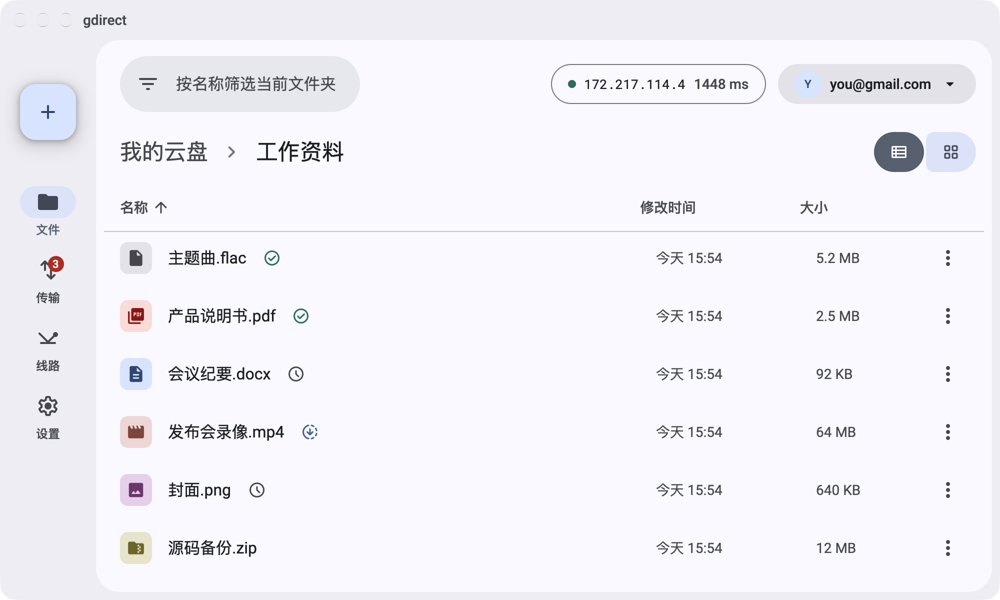
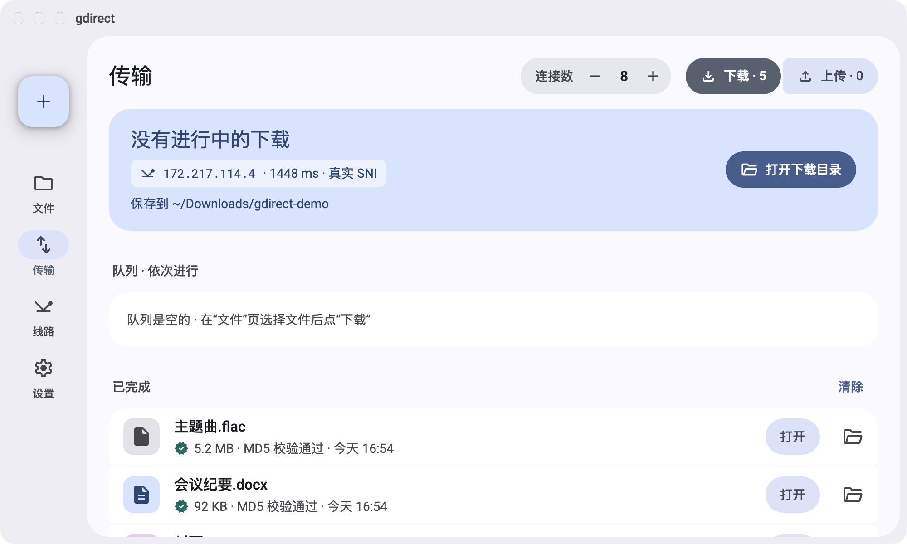
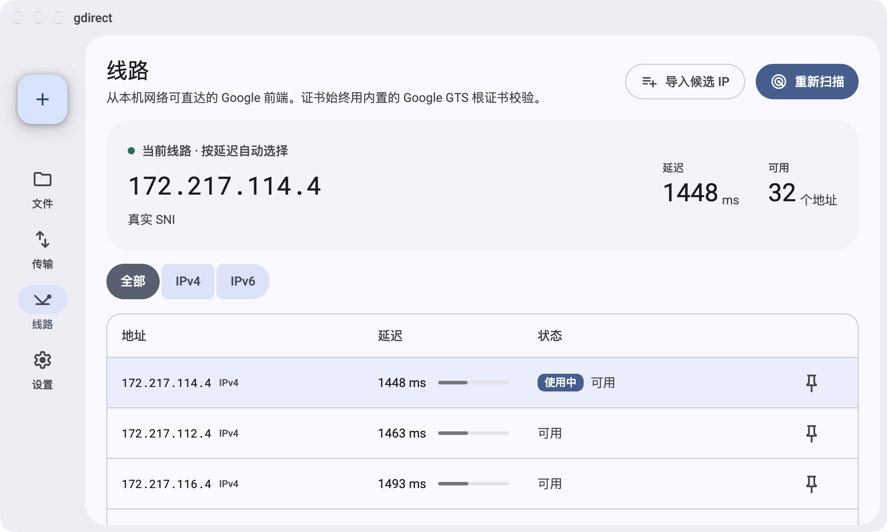
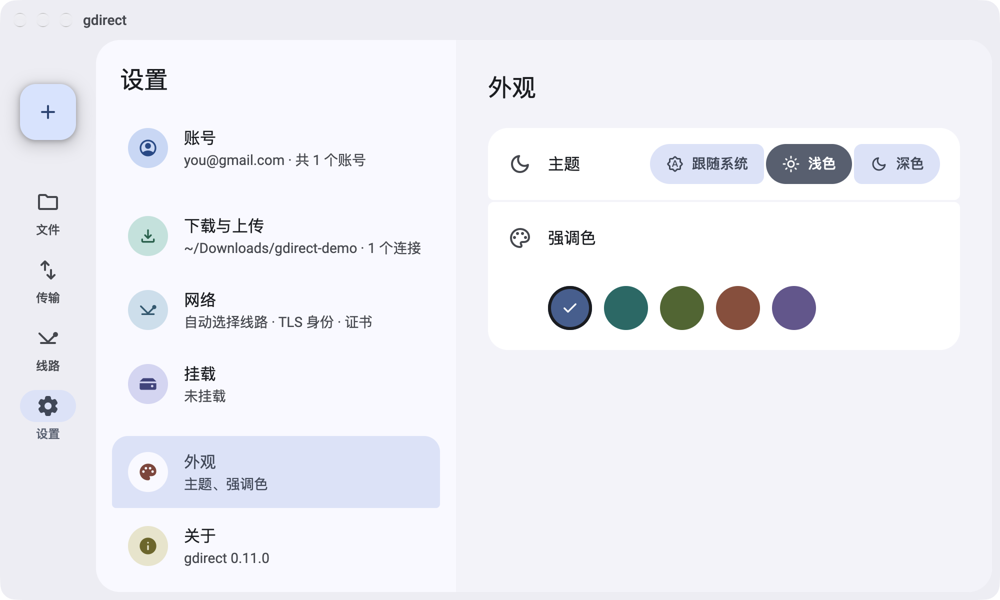

# gdirect

[](https://github.com/mizorewww/gdirect/releases/latest)
[](https://github.com/mizorewww/gdirect/actions/workflows/ci.yml)
[](LICENSE)

[English](README.md) · [更新日志](CHANGELOG.md)

在 Google 被屏蔽的网络里浏览、下载、上传和挂载 Google 云盘，传输本身不需要代理。gdirect 会找出当前网络仍能直连的 Google 前端 IP，让云盘流量直接连过去，下载支持多连接和断点续传。

<picture>
  <source media="(prefers-color-scheme: dark)" srcset="docs/images/files-dark.png">
  
</picture>

<p align="center"><a href="https://github.com/mizorewww/gdirect/releases/latest/download/gdirect-desktop-windows-x64.msi"></a></p>

<p align="center"><a href="https://github.com/mizorewww/gdirect/releases/latest/download/gdirect-desktop-macos-arm64.zip"></a></p>

<p align="center"><a href="https://github.com/mizorewww/gdirect/releases/latest/download/gdirect-desktop-macos-x64.zip"></a></p>

<p align="center"><a href="https://github.com/mizorewww/gdirect/releases/latest/download/gdirect-desktop-linux-x64.tar.gz"></a></p>

- **直连传输：** 扫描 Google 自己的前端，只用能连通的那些；证书按程序内置的 Google 根证书校验。
- **快且可续传：** 每个下载最多 16 条连接，完成后校验 MD5；下载和上传中断后都能接着传。
- **终端和桌面：** 终端里有仿 yazi 的文件浏览器和适合脚本的命令，另有桌面客户端（预览）。
- **挂载：** 通过 rclone 把云盘挂成本地文件夹，同样不需要代理。
- **多账号**，使用你自己的 Google OAuth 客户端，数据不经过任何第三方。

## 快速开始

**1. 安装**（macOS 15+、Linux x86_64 且 glibc 2.35+、Windows x86_64）

```sh
# macOS / Linux
curl -fsSL https://raw.githubusercontent.com/mizorewww/gdirect/main/scripts/install.sh | bash
# 或者用 Homebrew（Homebrew 7 要求先信任第三方 tap 才能安装）
brew tap mizorewww/gdirect https://github.com/mizorewww/gdirect && brew trust mizorewww/gdirect
brew install mizorewww/gdirect/gdirect
```

```powershell
# Windows PowerShell
& ([scriptblock]::Create((Invoke-RestMethod 'https://raw.githubusercontent.com/mizorewww/gdirect/main/scripts/install.ps1')))
```

加上 `--with-mount`（PowerShell 用 `-WithMount`）会顺带安装挂载所需的依赖。各平台的安装包见 [Releases](https://github.com/mizorewww/gdirect/releases/latest)。

**2. 创建你的 Google 客户端**——只需一次，约 10 分钟：按 [Google 配置指南](docs/configuration/README.zh-CN.md) 下载 *Desktop app（桌面应用）* 类型的 OAuth 客户端 JSON。

**3. 登录**——浏览器会自动打开。登录需要能正常访问 Google，如果 Google 被屏蔽，这一步请开着代理：

```sh
gdirect login --client-secret ~/Downloads/client_secret.json
```

**4. 开始使用**

```sh
gdirect                          # 浏览云盘；按 ? 查看按键，d 下载，u 上传
gdirect download 文件ID或分享链接  # 保存到 ./downloads
gdirect upload ./photos -r       # 上传文件夹，中断后重新执行即可续传
gdirect mount                    # 挂载到 ~/GoogleDrive
```

第一次传输时会扫描可直连的 Google IP，大约需要一分钟。

> [!IMPORTANT]
> 开着 TUN 模式的代理或 VPN（例如 Clash TUN）？请把 Google 的 IP 段设为 **DIRECT 直连**并关闭 fake-ip，否则扫描测到的是代理而不是你的网络。详见[网络与代理](docs/network.zh-CN.md)。

## 桌面客户端（预览）

同一套引擎的 Material 3 窗口：浏览和管理文件、把文件拖进来上传、查看传输队列、扫描和固定线路、切换账号。它和命令行共用登录信息与设置，界面语言跟随系统（中文或英文），窄窗口下也能正常使用。

| 传输 | 线路 | 设置 |
| --- | --- | --- |
|  |  |  |

点页面顶部的按钮下载，或者到 [Releases](https://github.com/mizorewww/gdirect/releases/latest) 下载：

- **macOS：** 解压后把 `gdirect.app` 拖进“应用程序”，或者按[快速开始](#快速开始)添加并信任 tap 后执行 `brew install --cask mizorewww/gdirect/gdirect-desktop`。应用没有经过公证：第一次打开后，到“系统设置 › 隐私与安全性”里点“仍要打开”。
- **Windows：** 运行 `gdirect-desktop-windows-x64.msi`，装好后在开始菜单里打开 gdirect。SmartScreen 可能提示发布者未知：点“更多信息 › 仍要运行”。
- **Linux（x86_64，glibc 2.35+）：** 解压后在目录里执行 `./install.sh` 添加菜单项，或者直接运行 `gdirect-desktop`。

想自己编译，见[从源码编译](docs/building.zh-CN.md#桌面客户端)。

## 文档

- [使用说明](docs/usage.zh-CN.md)——全部命令、`browse` 按键、多账号、挂载、数据存放位置
- [网络与代理](docs/network.zh-CN.md)——各类流量的走向、扫描、TUN 和系统代理的配置
- [Google 配置与常见问题](docs/configuration/README.zh-CN.md)——OAuth 客户端、登录问题、7 天过期
- [从源码编译](docs/building.zh-CN.md)——命令行和桌面客户端

## 许可证

[GPL-2.0-or-later](LICENSE)
